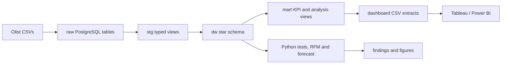

# Olist E-commerce Analytics

A reproducible analytics project that turns the [Brazilian E-Commerce Public Dataset by Olist](https://www.kaggle.com/olistbr/brazilian-ecommerce/home/) into a PostgreSQL warehouse, analysis-ready marts, statistical findings, a revenue forecast, and CSV extracts for a Tableau Public or Power BI dashboard. It is designed as a readable Data Analyst portfolio project: plain SQL, a small Python runner, and explicit data quality checks.

> **Current status:** The full pipeline passed locally with the nine source CSVs on 24 October 2026. A three-page local HTML dashboard is available in `dashboard/Olist_dashboard.html`. A Tableau Public workbook and screenshots remain owner tasks.

## What it answers

- How did delivered order revenue, order count, and AOV change over time?
- Where are delivery delays associated with lower review scores?
- Which categories and sellers account for the most revenue?
- How many customers return, and what does a simple forecast predict?

## Architecture



`dw.fact_orders` has one row per order; `dw.fact_order_items` has one row per item. Customer analysis uses `customer_unique_id`, which identifies a person across orders. See [architecture](docs/architecture.md) and the [data dictionary](docs/data_dictionary.md).

## Stack

PostgreSQL 16 in Docker Compose, Python 3.11+, pandas, SQLAlchemy, psycopg 3, SciPy, statsmodels, scikit-learn, matplotlib, pytest, and plain SQL. Tableau Public or Power BI is used for the manual dashboard.

## Quick start

1. Install Docker with a running daemon and Python 3.11 or newer.
2. Download the nine CSV files from the [Olist dataset](https://www.kaggle.com/olistbr/brazilian-ecommerce/home/) and put them in `data/raw/` with their original filenames. Kaggle sign-in may be required. The files are ignored by Git.
3. Create a local environment and set a password:

   ```bash
   python3 -m venv .venv
   source .venv/bin/activate
   pip install -r requirements.txt
   cp .env.example .env
   # Edit POSTGRES_PASSWORD in .env before starting Docker.
   ```

4. Run the pipeline:

   ```bash
   make all
   ```

`make all` starts PostgreSQL, reloads raw CSVs, rebuilds staging/warehouse/marts, runs data quality checks and Python analyses, writes dashboard extracts, rebuilds the local dashboard, and runs tests. A second run replaces prior derived data instead of duplicating it. If CSVs are missing, ingestion lists every missing filename. `make down` stops the database container while retaining its named volume.

For step-by-step work, use `make up`, `make ingest`, `make build`, `make check`, `make analyze`, `make export`, `make dashboard`, and `make test`. Open [the profiling notebook](notebooks/01_eda.ipynb) to inspect source quirks. The [data dictionary](docs/data_dictionary.md) records the observed January 2017–August 2018 analysis window and data exceptions.

## Dashboard and results

Open the [local three-page dashboard](dashboard/Olist_dashboard.html) directly in a browser. It is self-contained and filters order-based views by month and customer state. Its aggregate-only source files are in `dashboard/public_extracts/`; regenerate it with `make dashboard` after `make export`. The [dashboard spec](dashboard/DASHBOARD_SPEC.md) and [beginner Tableau guide](dashboard/TABLEAU_BEGINNER_GUIDE.md) remain available for a Tableau Public version.

The verified January 2017–August 2018 window has **BRL 13.18 million delivered item revenue** across **96,211 delivered orders** (AOV **BRL 137.00**). The measured late-delivery rate is **6.8%**; **3.0%** of customers made more than one delivered purchase. See [findings](docs/findings.md) for tests, effect sizes, recommendations, and the forecast. Charts appear in `reports/figures/`.

## Project layout

| Path | Purpose |
|---|---|
| `sql/` | Schemas, raw/staging/warehouse/mart SQL, and quality assertions |
| `src/` | Ingestion, SQL runner, checks, analyses, and CSV export |
| `notebooks/01_eda.ipynb` | Source profiling and analysis-window evidence |
| `tests/` | Pure Python tests and an optional built-database check |
| `docs/` | Architecture, data dictionary, learning notes, and generated findings |
| `dashboard/` | Extracts, build spec, and owner-added screenshots |
| `reports/figures/` | Generated charts |

## Limitations

- This is historical marketplace data from one source; results do not describe current performance.
- Repeat purchase is low in the measured window (3.0% of customers); cohort and RFM interpretations are acquisition-heavy.
- The forecast uses a three-month holdout and a simple model; its shaded band is an approximate residual range, not a calibrated prediction interval.
- `orders_flat.csv` assigns a multi-category order to its highest-priced item's category for order-level filtering. Use `category_performance.csv` for exact item-category revenue.
- The local HTML dashboard is built; a Tableau Public workbook and screenshots have not been published. A fresh clone needs the nine source CSVs and a running Docker daemon to reproduce these numbers.

## Interview guide

Read [learning notes](docs/LEARNING.md) for short explanations of grain, star schemas, window functions, p-values, effect sizes, and forecast baselines. The project choices and data exceptions are recorded in the [data dictionary](docs/data_dictionary.md).
