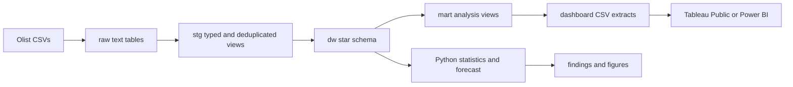
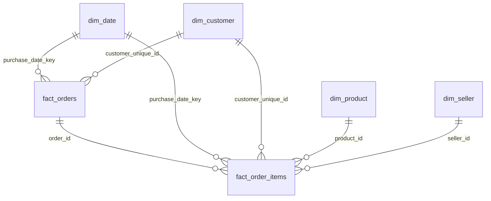

# Architecture

The SQL runner applies files in numeric order in one transaction. Rebuilding replaces the warehouse and marts; a failed build rolls back. Ingestion truncates and reloads all raw tables in one transaction.

`fact_orders` has one row per source order. `fact_order_items` has one row per `(order_id, order_item_id)`. Customer identity uses `customer_unique_id`; the source `customer_id` identifies an order-specific customer record.
